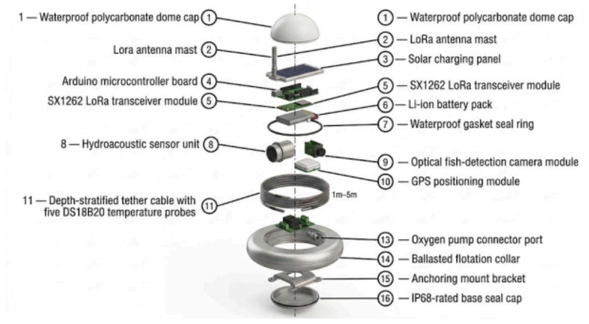
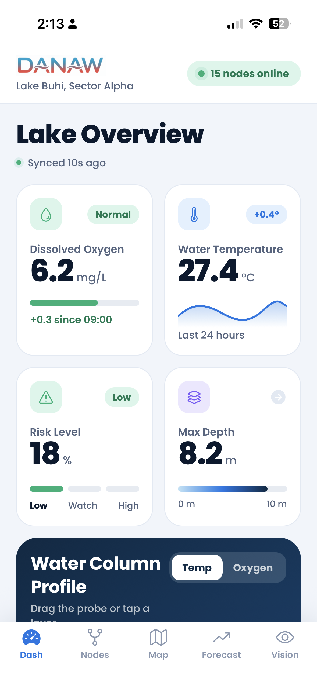
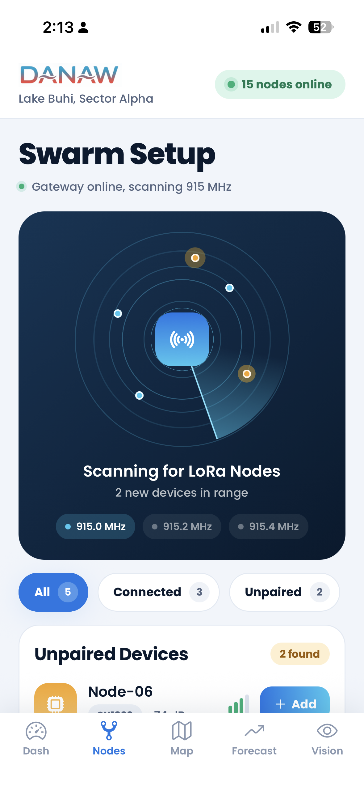
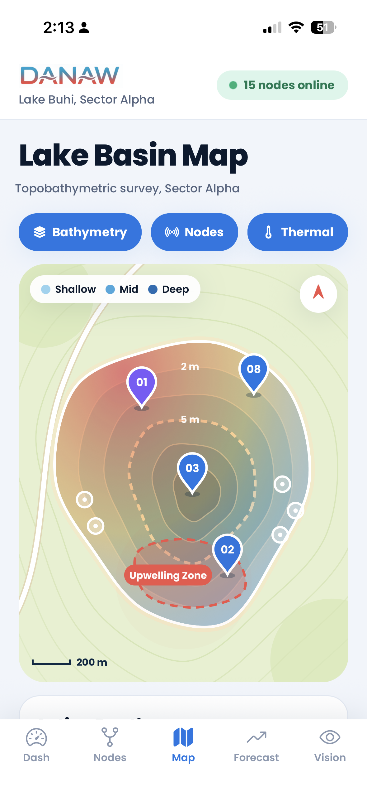
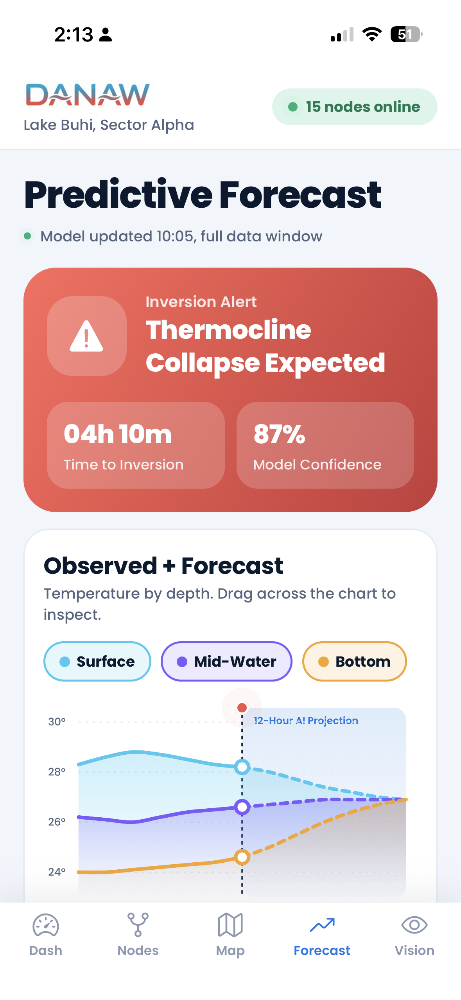
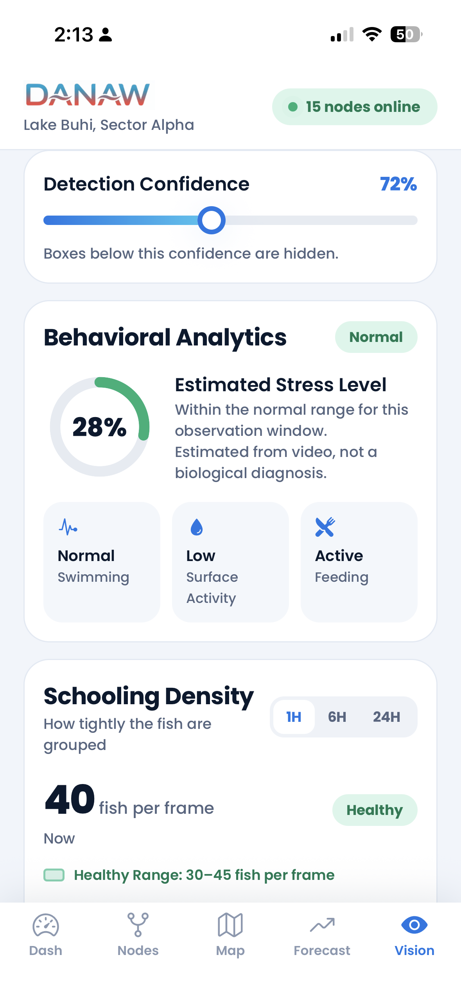

# DANAW

> **Depth-stratified Aquatic Network for Anticipating Water-inversions**
> A decentralized early-warning platform that helps tilapia farmers in Lakes Buhi and Bato see a lake turnover (*Overtoun*) coming and prevent fish kills.


Built for the **Philippine Startup Challenge XI**.

**Documents:** [Concept note (PDF)](docs/DANAW-Concept-Note.pdf)

---

## About DANAW

Lake overturns in Lakes Buhi and Bato can wipe out 30 to 40% of a tilapia harvest in a single cycle. Farmers rely on manual surface sampling, which only shows the problem after the fish are already stressed, and commercial monitors cost PHP 30,000 to 80,000 or more per unit.

DANAW combines low-cost buoy nodes that measure the water column at several depths, an offline Meshtastic LoRa mesh network that works without cellular signal, and forecasting models that predict a thermocline inversion hours ahead. This repository contains the **mobile command app**, where a farmer sees the alert and switches on aerators and oxygen pumps remotely.

## How it works

1. **Buoy nodes** (Arduino-based, IP68) measure water temperature at several depths.
2. **Meshtastic LoRa mesh** carries the data up to 15 km to a shore gateway.
3. **Forecasting models** combine live readings with lakebed (LiDAR) maps to predict an inversion.
4. **This app** shows the alert and sends reverse-mesh commands to aerators and pumps.

---

## Hardware design

> IP68-rated buoy node with a multi-depth temperature array and a LoRa antenna.

<p align="center">
  
</p>

---

## App preview

<table>
  <tr>
    <td align="center"><br/><b>Dashboard</b></td>
    <td align="center"><br/><b>Swarm Nodes</b></td>
    <td align="center"><br/><b>Spatial Map</b></td>
    <td align="center"><br/><b>Forecast</b></td>
    <td align="center"><br/><b>Vision</b></td>
  </tr>
</table>

---

## Core modules

### 1. Dashboard
- **Water column profile:** drag a probe through three layers (Surface, Mid-Water, Bottom) and switch between temperature and oxygen.
- **Live readings:** dissolved oxygen, water temperature, risk level and max depth, each opening its related screen.
- **Remote actuation:** switch aerators and the O₂ pump station over the LoRa control hub.

### 2. Swarm Nodes
- **Node scanning and pairing** with a live radar view.
- **Network topology** showing node roles, battery, signal and data flow.
- **Filters** for All, Connected and Unpaired devices.

### 3. Spatial Map
- **Bathymetry map** with depth contours, fish cages, an upwelling hazard zone and a thermal overlay.
- **Node inspection:** tap a pin to open its temperature, oxygen and signal readings.

### 4. Predictive Forecast
- **Inversion alert** with a countdown and model confidence.
- **Observed + Forecast chart** across three depths, with a draggable scrubber.
- **Why this alert?** shows the signals that drive the forecast.
- **One-tap pre-emptive aeration** with a confirm step and node acknowledgements.

### 5. Vision
- **Camera feed** with detection boxes and an adjustable confidence threshold.
- **Behavioral analytics:** estimated stress level and schooling density with a healthy range.
- **Event timeline** of notable behavior changes.

---

## Tech stack

- **App:** React Native, Expo, Expo Router, TypeScript, react-native-svg
- **Planned hardware:** Arduino, DS18B20 temperature probes, hydroacoustic and optical sensors, SX1262 LoRa, Meshtastic
- **Planned intelligence:** time-series forecasting (LSTM) and a CNN for fish behavior

## Run it locally

You need Node.js and the **Expo Go** app on your phone.

```bash
git clone https://github.com/mzep98/danaw.git
cd danaw
npm install
npx expo start
```

Scan the QR code with your phone camera (iPhone) or the Expo Go app (Android).

> The Vision screen needs a sample fish photo, which is not included. Add any fish or aquarium photo you have rights to as `assets/images/fish.jpeg` before starting.

## Prototype status

This repository is a working app prototype. Sensor readings, forecasts, camera detections and device commands are **simulated**. The buoy hardware, forecasting models and LiDAR basemaps are described in the project concept note and are not yet part of this repository.

## Roadmap

1. Hardware prototyping and lakebed mapping (months 1 to 3)
2. Firmware and forecasting model training (months 4 to 5)
3. 10-unit pilot deployment and field validation (months 6 to 8)
4. Scaling to 50 units and municipal data contracts (months 9 to 12)

## Repository structure

```
app/          screens and tab navigation
assets/       images (screenshots, 3D render, logo)
components/   shared UI (AppText, Card, Screen)
constants/    theme: colors, gradients, shadows
context/      shared lake state
docs/         project documentation
```

## Team

Kaiser Francis L. Badiong, Marqus Szymon E. Pelagio and Eunice Nullan

Coach: Engr. John Roy Galvez, CCPE, CRS

## License

The code is released under the [MIT License](LICENSE). The DANAW name and logo are not covered by that license.
